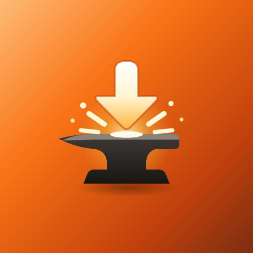
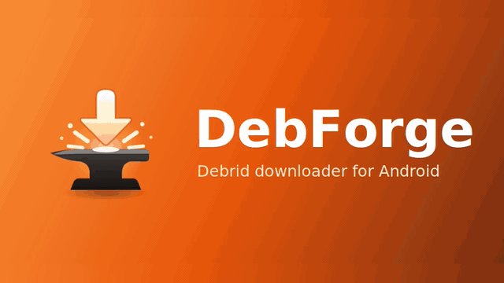

# DebForge

**Your debrid cloud, on your phone, tablet and TV.**
Add a magnet, watch it land, play it anywhere. No PC in the middle.

<!-- Uncomment once DebForge is live on F-Droid:

-->

Prefer video? <a href="docs/demo/debforge.mp4">Watch the MP4</a>.

## Why DebForge

- 🎬 **A real library, not a file list.** Posters, clean titles like *The Bear · S02E05 · 1080p*, shows grouped into seasons, search across everything.
- ⚡ **Downloads that don't quit.** Up to 16 connections per file, pause and resume, expired links refreshed for you.
- ▶️ **Stream or save.** Play straight from your service in the built-in player, or watch offline from your downloads. Resume points, subtitles and next episode either way.
- 🔔 **Follow a show.** New episodes that reach your account download by themselves.
- 🧲 **Add from anywhere.** Tap a magnet, share a link, open a `.torrent`, or just copy a magnet and open the app.
- 📺 **Made for every screen.** Phones, tablets and Android TV with full remote support.
- 🔒 **Private by design.** No analytics, no trackers, keys encrypted on the device. Free and open source.

## Get started in 2 minutes

1. **Install.** Android 11 or newer. Pick one:
   - **Obtainium** (recommended): tap the badge above, or add `https://github.com/AbhinavXT/debforge` in Obtainium. It keeps DebForge updated for you.
   - **Manually**: download `DebForge-vX.Y.Z.apk` from [Releases](../../releases/latest) and open it. The app tells you when a new version is out.
   - **F-Droid**: submission in progress.

   All of them give you the **same APK signed with the same key**, so you can switch between them without losing your settings.
2. **Sign in to your service.** Open DebForge, pick your debrid service and paste your API key (Real-Debrid can also sign in with a device code, AllDebrid with a PIN). You can add more services later in Settings.
3. **Choose where files go (optional).** Downloads land in `Movies/DebForge` by default. Settings → Download folder takes any folder, SD cards and USB drives included, with no special permission.
4. **Optional: turn on posters.** Tap **Set up** on the Library banner. The app opens TMDB's free key page, pastes the key for you and checks it.
5. **Add something.** Tap **Add**, paste a magnet or link, and DebForge downloads it as soon as your service has it ready.

That's it. Extras like [Trakt](https://trakt.tv/) scrobbling, OpenSubtitles search, download rules and themes live in **Settings** when you want them.

## Supported services

| Service      | Sign-in              | Add magnets | Add .torrent | Add links |
|--------------|----------------------|:-----------:|:------------:|:---------:|
| TorBox       | API key              | ✓           | ✓            | ✓         |
| Real-Debrid  | Device code or token | –           | –            | ✓         |
| AllDebrid    | PIN or API key       | ✓           | ✓            | ✓         |
| Premiumize   | API key              | ✓           | ✓            | ✓         |
| Debrid-Link  | API key              | ✓           | ✓            | ✓         |

Sign in to as many as you like and switch in Settings. When adding, DebForge checks which of them already has the torrent cached and lets you choose.

## Everything it does

The full feature list

- **One app, many services.** Sign in to as many as you like and switch in Settings.
- **Fast, resumable downloads.** Up to 16 parallel connections per file, pause and
  resume, and automatic link refresh when a link expires.
- **Library view.** Posters and clean titles (e.g. "The Bear · S02E05 · 1080p"),
  series grouped into seasons, and search across your whole account.
- **No clutter.** The release group's "Downloaded from….txt", .nfo files, cover
  images and sample clips inside torrents are hidden and never auto-downloaded
  (Settings → Library → Show extra files brings them back).
- **Follow a show.** Tap Follow on a show and new episodes that reach your
  account (added by hand or by the service's own RSS/automation) download by
  themselves, one file per episode in the quality you had. Checked whenever the
  Library loads and every couple of hours in the background.
- **Add from anywhere.** Tap a magnet link, share a URL, or open a `.torrent`
  file. DebForge sends it to your service and, if you want, downloads it when it's ready.
- **Videos on a web page.** Paste a page's link and tap *Find videos on this page*:
  DebForge lists the video files the page links to (name and size, largest first)
  and downloads the ones you tick. Pages that build their player with JavaScript
  (YouTube and the like) and HLS/DASH-only streams aren't supported.
- **Widget, tile and shortcuts.** A home-screen widget shows what's downloading
  with Pause all / Resume all and Add; a Quick Settings tile pauses everything in
  one tap; long-press the app icon for Add and Resume all.
- **Copied a magnet?** Open DebForge and it offers to add it. Only magnets and
  .torrent links are offered, each copy once (can be turned off in Settings).
- **Play without downloading.** Stream any file in DebForge's own player
  (seek, speed, audio and subtitle tracks, Android TV remote) or hand it to VLC,
  mpv or MX Player (Settings → Library → Play videos in). Dolby Digital (Plus), DTS
  and TrueHD audio play even on phones without those decoders (FFmpeg); anything
  the device still can't decode is offered to your other player instead.
- **Watch your downloads offline.** Finished videos play in the same player from
  the Downloads tab, and the Library and Continue watching use the downloaded
  copy when there is one: no data, same resume point, subtitles and next episode
  from your downloads.
- **Continue watching.** DebForge's player remembers where you stopped in every
  file (even though debrid links change each time) and picks up there. A row at
  the top of the Library takes you back in, and episodes show progress or ✓ Watched.
- **Subtitles from the torrent.** Streaming a file, DebForge attaches the .srt /
  .ass / .vtt files that came with it (".en.srt", "Subs/<episode>/2_English.srt"),
  labelled by language. External players never see those when streaming a link;
  MX Player and VLC get them passed along too.
- **Subtitles online.** No subtitles in the torrent? Subtitles → Search online
  in the player finds them on OpenSubtitles (free API key of your own, Settings
  → OpenSubtitles). Files are matched by hash first, so the top results are
  timed for exactly your release.
- **Next episode.** Near the end of an episode, "Next: S03E03" counts down and
  the next one starts in the same player, its link fetched ahead of time. It
  prefers the same release and quality, and goes on into the next season.
- **No dead streams.** When a debrid link expires mid-watch (hours in, or after
  a long pause), the player quietly gets a fresh one and carries on from the
  same second. On Android TV the remote reaches every button.
- **Skip intro, recap and credits.** When an .mkv's chapters mark the opening,
  recap, credits or preview, a Skip button appears (or the intro is skipped by
  itself, Settings → Library). Without chapters, DebForge remembers where you
  skipped a show's intro and offers it there in the next episodes, TV remote included.
- **Trakt.** Connect your Trakt account (Settings → Trakt, with a free Trakt
  app of your own): what you watch in DebForge's player is scrobbled, and
  episodes and movies watched anywhere show ✓ Watched in the Library.
- **Picture-in-picture.** Leave the player while a video plays and it keeps going
  in a floating window, with play/pause and next episode (Settings to turn off).
- **Download rules.** Wi-Fi only, while charging, a nightly time window, and a speed limit.
- **Save anywhere.** Pick any folder with the system picker, including SD cards
  and USB drives, with no special permission.
- **Never runs out of space mid-download.** DebForge checks free space before
  queueing and before each file starts. A file that won't fit stops with a
  clear message instead of failing halfway. Optionally, finished downloads are
  deleted after 7–60 days (off by default, asks before deleting anything).
- **Keep your service tidy.** Remove torrents from the service in the app, or
  automatically once every file in one has downloaded, to free up slots.
- **Select many at once.** Long-press a poster or a file to select it, then
  download, remove from the service, or mark watched / unwatched together.
- **Several services, one Add button.** Signed in to more than one? The Add
  dialog checks every service that can tell whether a torrent is cached, picks
  one that has it (or one that can take magnets when Real-Debrid is active),
  and lets you choose. Premium expiry warnings cover every signed-in service.
- **Instant badge.** When adding, see whether TorBox or Premiumize already has
  the torrent cached. The other services have removed this check from their APIs.
- **Data usage.** This month's downloads split into Wi-Fi and mobile data, a
  30-day chart, and totals per service.
- **Backup and restore.** Move your settings and followed shows to another phone. Sign-ins can be
  included, encrypted with a password you choose.
- **Organised library.** Optional Plex/Jellyfin layout
  (`Shows/Name/Season 01`, `Movies/Name (Year)`).
- **TorBox extras.** Download a whole torrent as a single zip.
- **Themes.** Seven colour themes (Ember, Ocean, Aurora, Forest, Amethyst, Rose,
  Graphite) in light or dark, a pure-black mode for OLED screens, and your
  wallpaper colours on Android 12 and later.
- **Android TV and tablets.** Leanback launcher support and a side navigation rail
  on wide screens.
- **14 languages.** English, Hindi, Bengali, Tamil, Telugu, Marathi, Spanish,
  Portuguese (Brazil), French, German, Russian, Indonesian, Turkish and
  Simplified Chinese, with a per-app language setting on Android 13+.

## Privacy

- API keys are encrypted on the device with a key held in the Android Keystore, and are excluded from backups.
- The app talks only to your debrid service, to TMDB for posters (if you add a key), and to GitHub to check for updates (you can turn this off in Settings → About).
- Backups contain your sign-ins only if you choose to include them, and then only encrypted with your password (PBKDF2 + AES-256-GCM).
- There are no analytics and no crash-reporting SDK. If the app crashes, a report with tokens, links and file names removed is saved on the device. On the next launch you're asked whether to share it; nothing is sent automatically.

## Contributing

Want to build it, translate it, or add a service? See [DEVELOPMENT.md](DEVELOPMENT.md) and [PROVIDERS.md](PROVIDERS.md).

## Support

DebForge is free, with no ads and no tracking. If it saves you time, you can [buy me a coffee](https://buymeacoffee.com/abhinavxt) ☕

## License

DebForge is free software under the [GNU General Public License v3.0 or later](LICENSE).
